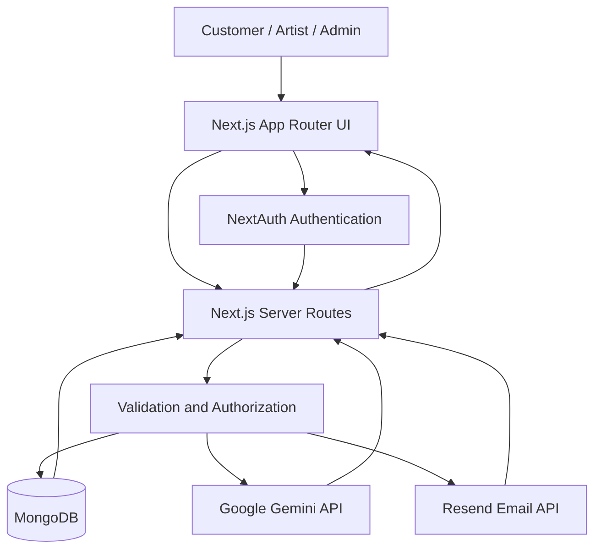
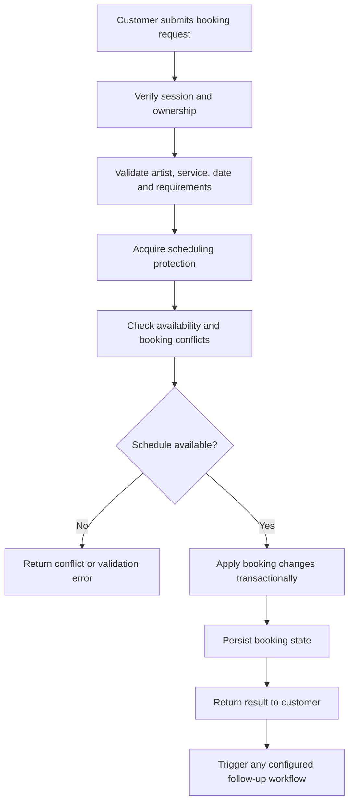
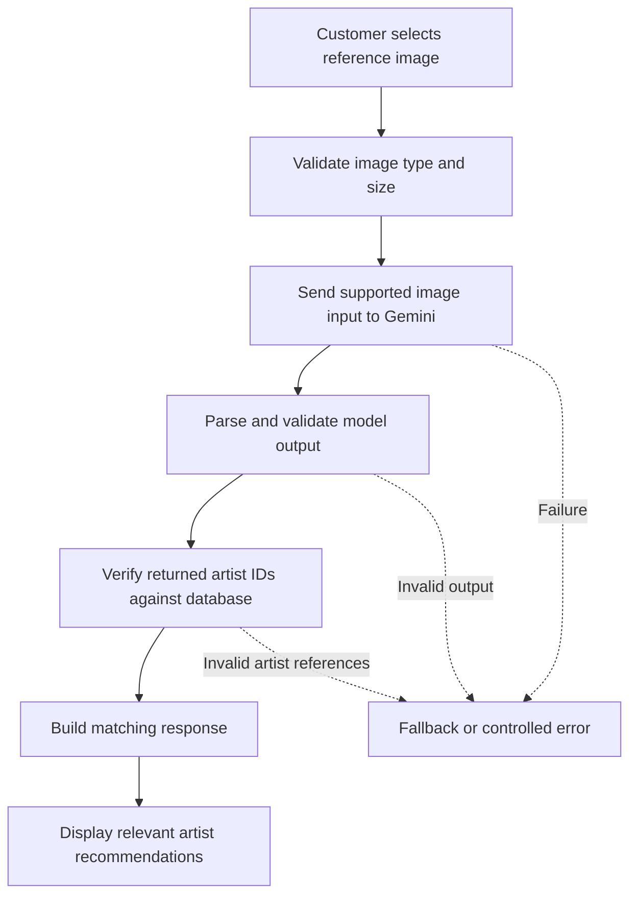

# Kajal Cartel — AI-Powered Bridal Beauty Marketplace

**Discover the right makeup artist for your vision.**

[](https://kajal-cartel.vercel.app/)
[](https://nextjs.org/)
[](https://www.typescriptlang.org/)
[](https://www.mongodb.com/)

Kajal Cartel is a bridal beauty marketplace designed to help customers discover makeup artists based on their aesthetic preferences, compare service pricing, manage bookings, and organize their bridal inspiration. It combines image-assisted AI matching with a structured booking platform and role-based experiences for customers, artists, and administrators.

**Live application:** https://kajal-cartel.vercel.app/  
**Source code:** https://github.com/singhsrivass1/Kajal-Cartel

---

## Table of Contents

- [1. The Problem](#1-the-problem)
- [2. The Solution](#2-the-solution)
- [3. Core Features](#3-core-features)
- [4. System Architecture](#4-system-architecture)
- [5. Key Workflows](#5-key-workflows)
- [6. Technology Stack](#6-technology-stack)
- [7. Security and Data Integrity](#7-security-and-data-integrity)
- [8. Project Structure](#8-project-structure)
- [9. Local Development](#9-local-development)
- [10. Environment Configuration](#10-environment-configuration)
- [11. Testing and Verification](#11-testing-and-verification)
- [12. Deployment Considerations](#12-deployment-considerations)
- [13. Limitations and Future Improvements](#13-limitations-and-future-improvements)

## 1. The Problem

Finding a suitable bridal makeup artist often involves browsing social media, manually comparing portfolios, requesting quotations, and trying to determine whether an artist can reproduce a particular look.

This creates friction for both sides of the marketplace:

- **Customers** struggle to translate visual inspiration into useful search criteria and compare artists consistently.
- **Artists** spend time responding to inquiries that may not match their style, availability, or service offerings.
- **Booking coordination** becomes difficult when availability, event requirements, pricing, and customer details are managed through separate conversations.

## 2. The Solution

Kajal Cartel brings artist discovery, AI-assisted visual matching, service pricing, booking management, reviews, and bridal planning into one platform.

Its goal is to make the discovery process more visual and the booking process more structured.

The application is built around three primary user groups:

| User | Primary capabilities |
|---|---|
| Customer | Discover artists, explore services, manage bookings, save artists, write eligible reviews, and organize moodboards |
| Artist | Access the artist portal and view permitted booking-related information |
| Administrator | Manage platform operations, review bookings, moderate reviews, and access administrative views |

The exact permissions and available actions depend on the account's server-verified role.

## 3. Core Features

### 3.1 AI-Assisted Artist Matching

Customers can use a visual reference to discover artists whose work may align with the intended look.

The AI integration uses the Google Gemini API. Image validation, model-output handling, artist verification, and fallback behavior are important parts of the matching workflow.

AI recommendations are decision-support results, not guarantees that an artist can reproduce a look exactly.

### 3.2 Artist Discovery and Service Catalog

- Browse artist profiles and portfolios.
- Explore service listings and individual service details.
- Review available pricing information and service options.
- Use discovery filters and compare relevant artists.
- Access dedicated policy and help pages.

### 3.3 Pricing Estimates

The platform supports server-side price estimation based on configured artist pricing, event requirements, group quantities, and eligible add-ons.

The calculation can account for minimum charges, tiered group discounts, and a deposit estimate where configured.

**Important:** A price estimate is not a completed payment or a guarantee of the final amount. Kajal Cartel does not implement payment processing merely by calculating a deposit.

### 3.4 Customer Accounts and Journey Dashboard

Authenticated customers can access account-related features, including:

- Profile information.
- Booking history and booking details.
- Permitted cancellation and rescheduling actions.
- Saved artists.
- Personal bridal-planning moodboards.

Access to customer-specific records must be restricted to their owner.

### 3.5 Booking Management

Booking operations include server-side validation of requests, scheduling constraints, booking-state rules, and conflict prevention.

The intended outcome is to prevent overlapping appointments and inconsistent updates when multiple requests affect the same artist's schedule.

Cancellation and rescheduling are governed by configured booking policies rather than unrestricted client-side actions.

### 3.6 Reviews and Moderation

The review workflow is designed to associate reviews with eligible completed bookings. It includes restrictions against duplicate reviews for the same booking, author-controlled changes, and administrative moderation.

Only published reviews should contribute to publicly displayed review summaries.

### 3.7 Bridal Moodboards

Customers can organize bridal inspiration into planning boards containing relevant event information, preferences, references, and related artist or service selections.

Private board data and uploaded images require ownership checks so that one customer cannot access another customer's private planning materials.

### 3.8 Administrative and Artist Portals

The administrative interface supports operational views such as booking management, customer information, review moderation, and platform statistics.

The artist portal provides a separate, restricted experience. Artist permissions must not be inferred from a client-supplied role or from access to a frontend page alone.

## 4. System Architecture

### High-level architecture



The Next.js application handles the user interface and server-side application logic. Server routes validate requests, verify authorization, and interact with MongoDB or external services when required.

### Main architectural components

| Component | Responsibility |
|---|---|
| Next.js App Router | Page routing, server-rendered UI, and application organization |
| TypeScript | Static typing across application code |
| NextAuth.js | Authentication and session handling |
| MongoDB | Persistent application data |
| Mongoose | Database schemas, models, and query operations |
| Gemini API | AI-assisted image analysis and artist matching |
| Resend | Email delivery where configured and invoked |
| Tailwind CSS | Utility-based styling |
| Framer Motion | Interface animation |
| Vercel | Application hosting and deployment |

### Booking workflow



The diagram describes the logical workflow. Exact transaction boundaries, persistence operations, and follow-up behavior must be confirmed against the current source code.

### AI matching workflow



AI-generated data should be treated as untrusted input. Database-backed artist records and server-side validation remain authoritative.

## 5. Key Workflows

### Customer booking lifecycle

1. The customer signs in and selects an artist or service.
2. The application validates the customer's identity and booking request.
3. The server checks the relevant artist, service, schedule, and booking constraints.
4. Scheduling protection and database consistency mechanisms prevent conflicting operations.
5. The booking is persisted if the applicable checks succeed.
6. The customer can view the booking and use only the actions permitted by its current state and booking policy.

### Authentication and authorization

1. The user authenticates through the configured authentication provider.
2. The application establishes a session.
3. Server-side code resolves the user's trusted identity and role.
4. Each protected API checks authentication, permissions, and record ownership as appropriate.
5. Unauthorized requests are rejected without exposing private data.

Authentication establishes who the user is. Authorization determines what that user is allowed to do.

### Pricing estimation

1. The customer selects the required services or event quantities.
2. The server validates identifiers, quantities, and applicable add-ons.
3. Pricing rules are applied using configured data.
4. The server returns the calculated estimate.
5. The result is presented as an estimate, not a payment confirmation.

## 6. Technology Stack

| Technology | Use |
|---|---|
| Next.js 14 | Full-stack application framework |
| TypeScript | Application language and type safety |
| React | Component-based user interface |
| MongoDB | Document database |
| Mongoose | Object-document mapping and schema validation |
| NextAuth.js | Authentication and session management |
| Google Gemini API | Image-assisted AI matching |
| Resend | Email delivery integration |
| Tailwind CSS | Styling |
| Framer Motion | Animations |
| Vercel | Hosting and deployment |
| Node.js | Server-side JavaScript runtime |

The exact package versions and active integrations should be verified in `package.json` and the current application configuration.

## 7. Security and Data Integrity

Security is enforced primarily on the server, not through frontend visibility alone.

Key areas include:

- **Authentication:** Validate the session before performing protected operations.
- **Role-based authorization:** Check the authenticated user's role on administrative and artist-specific routes.
- **Ownership checks:** Restrict customer records, bookings, and private moodboards to authorized users.
- **Input validation:** Validate identifiers, quantities, image inputs, and booking fields.
- **Redirect validation:** Prevent unsafe callback destinations.
- **AI output validation:** Verify generated data and artist references before using them.
- **Booking consistency:** Use appropriate database transactions, scheduling protection, and conflict checks.
- **Privacy:** Avoid exposing unnecessary personal information in administrative or artist-facing responses.
- **Configuration security:** Keep credentials in environment variables and never commit secrets.

### Booking concurrency

Two customers may attempt to reserve the same artist and time simultaneously. A simple availability check is insufficient because both requests could observe the same initially available slot.

The booking implementation must coordinate conflicting requests and revalidate availability before committing changes. MongoDB transactions require a deployment that supports transactions, such as a replica set or supported sharded cluster. Scheduling locks and database transactions address related but distinct concerns.

## 8. Project Structure

The repository should be consulted for the authoritative current structure. Important areas include:

```text
src/
├── app/              # Pages, layouts and API routes
├── components/       # Reusable UI components
├── lib/              # Shared logic, database and integrations
└── ...               # Additional application modules

docs/                 # Project and operational documentation
scripts/              # Development, verification and test scripts
public/               # Static assets
```

Use the actual directory names and paths from the repository when documenting specific modules. Do not assume every illustrative folder above exists.

## 9. Local Development

### Prerequisites

- Node.js version compatible with the repository's declared engine.
- npm.
- MongoDB deployment or local instance suitable for the application's database operations.
- Google OAuth credentials.
- Gemini API credentials for AI functionality.
- Resend credentials if email delivery is enabled.

### Installation

Clone the repository and enter the project directory:

```bash
git clone https://github.com/singhsrivass1/Kajal-Cartel.git
cd Kajal-Cartel
```

Install the dependencies using the package manager and instructions supported by the current lockfile:

```bash
npm install
```

If the repository's documented dependency compatibility requires a legacy peer-dependency installation, use that option only after confirming it is still necessary.

### Environment configuration

Create a local `.env.local` file in the project root. Use the variable names required by the current source code and `docs/configuration.md`.

Do not commit `.env.local`, production credentials, or real connection strings.

### Database setup

Configure the correct database URI before running any seed or data-modification script.

If the repository contains a seed script, inspect its behavior before executing it. Run it only against an explicitly selected development database; never assume a script is safe for production.

### Start the development server

```bash
npm run dev
```

Open:

```text
http://localhost:3000
```

Check the repository's `package.json` for the available build, type-check, and test scripts.

## 10. Environment Configuration

The following are representative configuration variables. Verify the current code and documentation before assuming every variable is mandatory.

| Variable | Purpose |
|---|---|
| `MONGODB_URI` | MongoDB connection string |
| `NEXTAUTH_SECRET` | Secret used by authentication/session configuration |
| `GOOGLE_CLIENT_ID` | Google OAuth client identifier |
| `GOOGLE_CLIENT_SECRET` | Google OAuth client secret |
| `GEMINI_API_KEY` | Gemini API access |
| `RESEND_API_KEY` | Resend email integration |
| `ADMIN_EMAIL` | Configured administrator email, where supported |
| `EMAIL_FROM` | Sender identity for email delivery, where supported |
| `EMAIL_DELIVERY_VERIFIED` | Email-delivery configuration flag, where supported |
| `NEXTAUTH_URL` | Canonical authentication URL when explicitly required |
| `NEXT_PUBLIC_SITE_URL` | Public site URL for supported metadata or URL generation |

Use separate credentials and database instances for development, preview, and production wherever practical. Do not paste actual secret values into documentation or terminal output.

## 11. Testing and Verification

Before a release, verify the following:

- TypeScript checks and production build pass.
- Authentication and role-based authorization work as intended.
- Customers cannot access another customer's private records.
- Booking conflicts are rejected under concurrent requests.
- Cancellation and rescheduling obey booking-state and timing rules.
- Pricing rejects invalid identifiers, quantities, and ineligible add-ons.
- AI output validation handles malformed responses and invalid artist references.
- Reviews follow eligibility and moderation rules.
- Private moodboard resources enforce ownership checks.
- Mobile layouts and important navigation flows work.
- Preview and production environments use the intended configuration.

Document actual test commands, test counts, and outcomes only after verifying them. A passing automated test suite does not replace end-to-end testing against the intended deployment environment.

## 12. Deployment Considerations

Kajal Cartel is hosted on Vercel.

Before promoting a deployment:

1. Confirm that the intended commit and build are being deployed.
2. Verify environment variables for the target Vercel environment.
3. Confirm the MongoDB deployment supports required transactions and indexes.
4. Ensure Preview uses an isolated database rather than production data.
5. Verify Google OAuth redirect URIs for the relevant deployment domain.
6. Test sign-in, booking, cancellation, rescheduling, and role-based access.
7. Review logs and errors, then verify the canonical production URL.

A successful build alone does not establish that database connectivity, OAuth, email delivery, or booking concurrency works correctly in production.

## 13. Limitations and Future Improvements

Potential improvements should be prioritized according to the actual deployed state:

- Add end-to-end browser tests for critical customer and administrator journeys.
- Improve operational monitoring, structured logs, and error reporting.
- Add background processing for operations that do not need to block user requests.
- Measure AI matching quality with representative reference images and human-reviewed outcomes.
- Improve accessibility and performance based on real testing.
- Add payment processing only through a dedicated, secure payment integration.
- Expand automated checks for booking concurrency, retries, and recovery behavior.

These are possible future improvements, not claims that the features are already implemented.

---

## Project Status

Kajal Cartel is available at [kajal-cartel.vercel.app](https://kajal-cartel.vercel.app/).

For implementation details, setup instructions, available scripts, and current operational requirements, refer to the repository's source code and documentation. Feature availability and production behavior should be verified against the live deployment.
